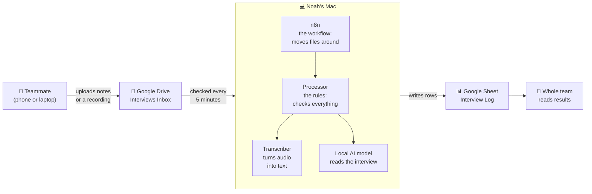
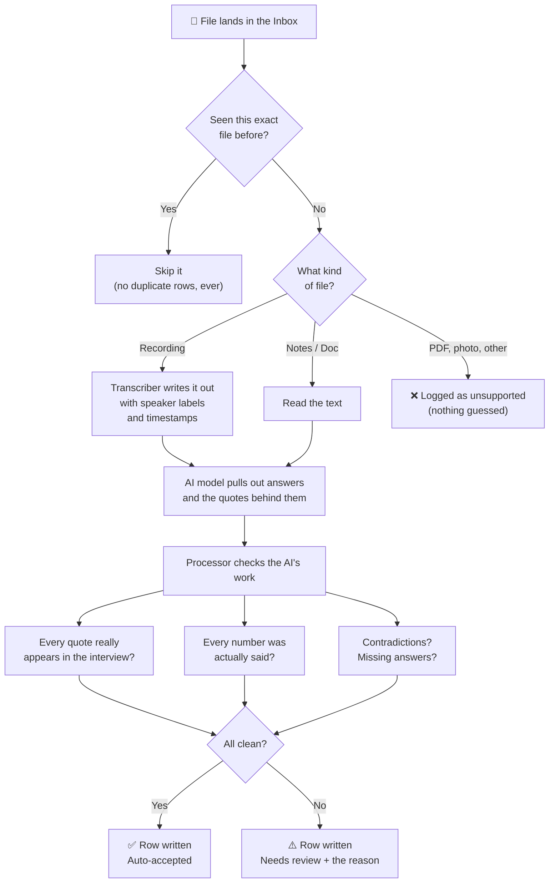

# SlopeCycle Interview Analyst

**An AI agent that turns our customer interviews into an organized, evidence-backed spreadsheet automatically.**

A teammate drops interview notes or a voice recording into a shared Google Drive folder. A few minutes later, a new row appears in our team spreadsheet. It shows how many kids the family has, what they spend, how they feel about renting, a short summary, and the exact quotes that back each answer. If anything is unclear, the row is marked **Needs review** and says why.

Nobody has to re-type or re-code an interview by hand, and the agent never fills in an answer the parent didn't give.

> Built for SlopeCycle's New Venture Creation agent assignment. SlopeCycle is a student venture testing season-long rental of kids' ski jackets and pants for Boulder and Front Range families.

---

## Who does what

| Person | What they do | How often | Guide |
|---|---|---|---|
| **Noah** | Installs the agent on his Mac and connects it to Google | Once, about 45 minutes | [Setup guide for Noah](docs/SETUP.md) |
| **Every teammate** | Uploads interviews to the shared folder and reads results in the sheet | Each interview, about 1 minute | [Guide for teammates](docs/TEAMMATES.md) |

Teammates install **nothing**. Everything runs on Noah's Mac.

---

## How it works (the big picture)

**In plain words:**

1. **The Inbox.** A shared Google Drive folder. Uploading a file there is how you hand an interview to the agent.
2. **n8n** (pronounced "n-eight-n"). A free tool that runs a workflow, meaning a fixed list of steps, like a recipe. Every 5 minutes it looks in the Inbox, picks up anything new, and passes it along.
3. **The processor.** The part that holds our rules. It decides whether a file is new, checks every answer against the interview, and refuses to make things up.
4. **The transcriber.** Turns recordings into text and labels who is speaking.
5. **The AI model.** Runs on Noah's Mac itself, not in the cloud. It reads the interview and pulls out the answers. **No interview ever leaves our Mac and our Google account.**
6. **The Google Sheet.** Where results land. One row per interview, plus tabs for quotes and a log of every run.

**Why one Mac and no server?** A server costs money and someone has to maintain it. Instead, files simply wait in the Inbox until Noah's Mac is awake, and then it catches up on everything. Nothing is lost if the Mac is asleep.

---

## What happens to one interview

---

## The n8n workflow

This is what the workflow looks like inside n8n. Each box is one step, and the colored notes explain each section in plain English.

**Part 1: find new files and hand them over** (steps 1–5)

| Section | What it does |
|---|---|
| 1. Two ways to start | A timer every 5 minutes, or the **Run now** button for demos |
| 2. Settings | The only place the folder and sheet addresses are written |
| 3. Look in the Inbox | Lists the files in the Inbox folder only, nothing else in Drive |
| 4. Ask the processor what to do | The processor answers with only the files that are new or changed |
| 5. One file at a time | Downloads each file and sends it to the processor |

**Part 2: save the results** (steps 6–7)

| Section | What it does |
|---|---|
| 6. Save to the Google Sheet | Writes transcript lines, then quotes, then the interview row, then the run log. Saving twice updates the same row instead of adding a copy |
| 7. Tell the processor how it went | "Saved", so the file is marked done, or "Save failed", so it gets retried later |

The workflow file is [workflow/slopecycle-interview-agent.json](workflow/slopecycle-interview-agent.json). Noah imports it into n8n during setup.

---

## What you get in the sheet

The Google Sheet has four tabs:

| Tab | One row per… | What's in it |
|---|---|---|
| **Interviews** | interview | Family situation, gear habits, spending, reaction to renting, a short summary, follow-up questions, and the review status |
| **Evidence** | quote | The exact words behind each answer and where they are (line number, or timestamp for recordings) |
| **Transcripts** | spoken line | The full written-out recording, so anyone can check a quote |
| **Run Log** | attempt | When each file was processed and whether it worked, failed, or was a duplicate |

Example of what a finished interview row says (synthetic test data):

| Field | Value |
|---|---|
| Kids who ski | 2 (ages 7 and 10) |
| Spending | "About $300 for both kids, jackets and pants only." |
| Per-child average | 150, *labelled as calculated: a household average, not what each child got* |
| Rental reaction | **conditional**: "would consider renting if swaps for a bigger size are free" |
| Review status | Auto-accepted |

---

## The rules it follows

These are enforced in code, not just requested of the AI:

- **No invented answers.** If the parent didn't say it, the cell stays blank and the summary says "Not provided". Blank does not mean "no".
- **Every claim has a quote.** Quotes the AI produces are checked word for word against the interview, and anything not found is thrown out and flagged.
- **Numbers must have been said.** If the AI reports "3 kids" and nobody said three, that number is removed.
- **"Maybe" is not "yes".** "I'd rent if swaps are free" is recorded as *conditional* interest, never as a sale.
- **Experts are not customers.** A ski-shop owner's opinion is labelled expert opinion and kept out of parent statistics.
- **No duplicates.** Uploading the same file twice, or pressing Run now twice, still gives one row.
- **Files can't give orders.** If an interview file contains instructions aimed at the AI, those lines are hidden from it and the row is flagged.
- **Private by design.** The AI runs on Noah's Mac. Interview content goes nowhere except our own Google account.

---

## How this meets the assignment

| Assignment asks for | Ours |
|---|---|
| A trigger | A new file in the Drive Inbox (checked every 5 minutes), plus a Run now button |
| A task or workflow | Transcribe, extract answers with evidence, check them, save |
| A connection to an outside tool | Google Drive (read) and Google Sheets (write) |
| An output it produces on its own | Interview rows, evidence, and a run log in the team sheet |
| Four failure tests | Bad input, missing data, duplicate trigger, failed connection: [test results](docs/test-results.md) |
| Prompt log | [What failed and what we changed](docs/prompt-log.md) |
| Workflow diagram | The diagrams above |
| Live demo | [Demo script](docs/DEMO.md) |

---

## More detail (for the curious)

- [How it's designed](docs/design.md), [key decisions and why](docs/adr/), [our vocabulary](CONTEXT.md)
- Code: `processor/` (Python: the rules), `transcriber/` (Swift: audio to text), `workflow/` (n8n), `fixtures/` (made-up test interviews, all labelled SYNTHETIC TEST DATA)
- License: MIT ([LICENSE](LICENSE)). Credits for the speech model and tools: [NOTICE.md](NOTICE.md)

### Words you'll see

| Word | Meaning here |
|---|---|
| **Agent** | Software that does a repeatable job on its own once it's triggered |
| **Workflow** | The fixed sequence of steps the agent follows |
| **Trigger** | What starts the workflow: here, a timer or the Run now button |
| **n8n** | The free tool that runs our workflow |
| **Local model** | An AI model that runs on our own computer instead of a company's servers |
| **Ollama** | The free app that runs the local model |
| **Transcript** | The written-out text of a recording |
| **Needs review** | The agent saved the row but wants a human to check something specific |
