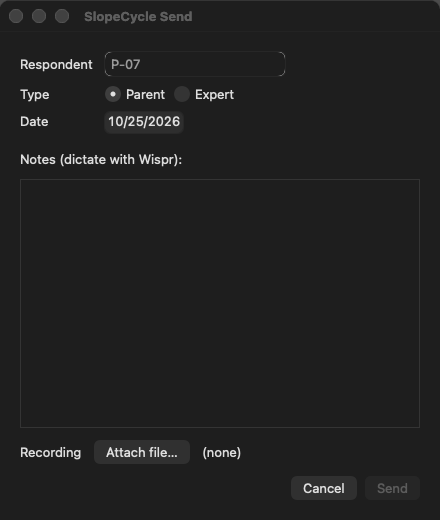
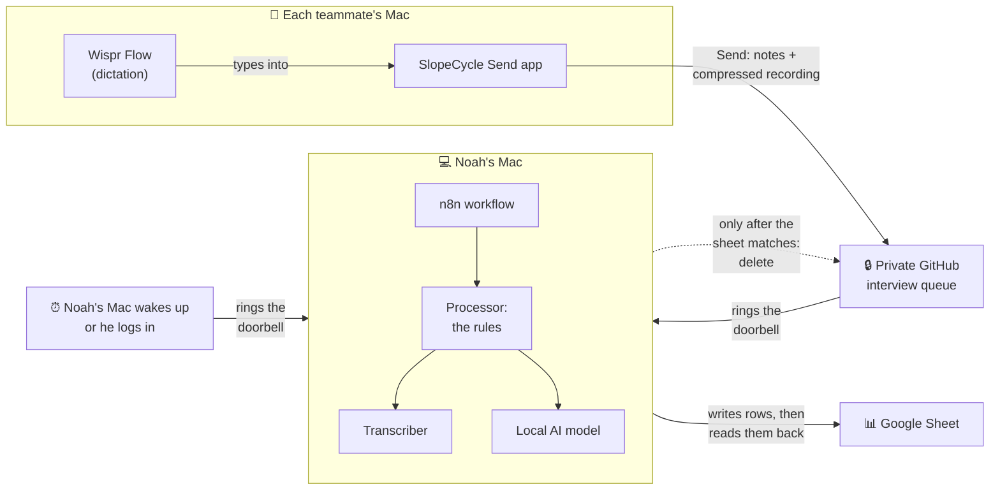
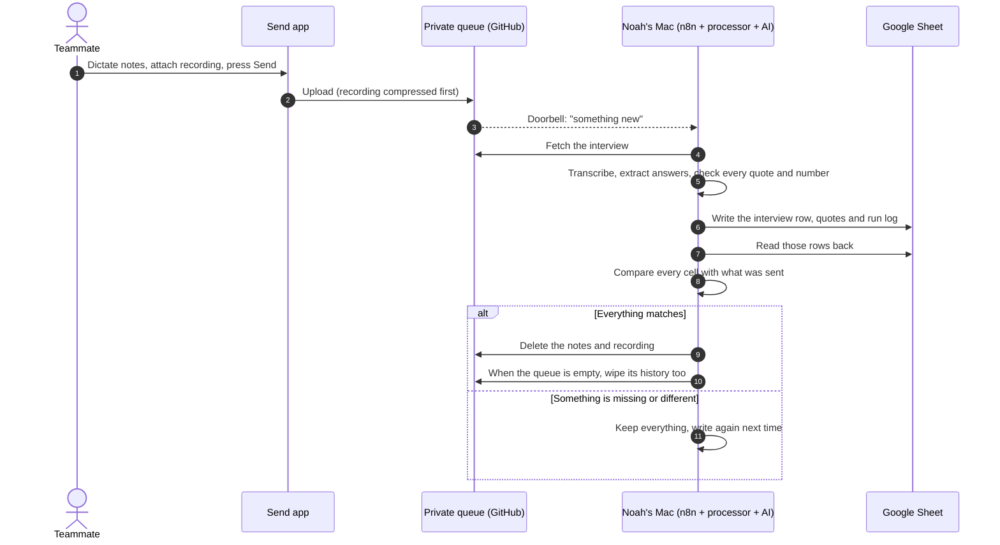
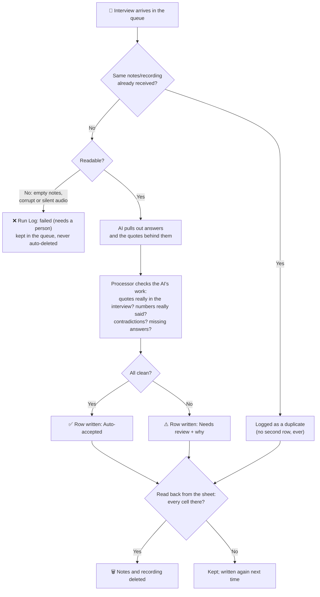
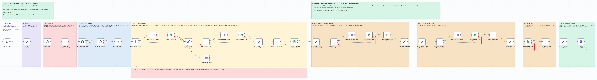
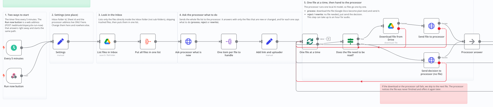
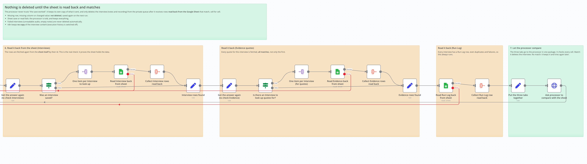

# SlopeCycle Interview Analyst

**An AI agent that turns our customer interviews into an organized, evidence-backed spreadsheet automatically.**

After an interview, a teammate opens the **SlopeCycle Send** app on their Mac, dictates their notes with Wispr Flow (and attaches the recording if they made one), and presses **Send**. Minutes later, a new row appears in our team spreadsheet. It shows the family's situation, what they spend, how they feel about renting, a short summary, and the exact quotes behind each answer. Anything the interview didn't cover says **"Not collected in interview"**, never a guess. Anything unclear is marked **Needs review** with the reason.

Then the agent **deletes the notes and recording**, but only after reading the spreadsheet back and confirming that every cell arrived.

> Built for SlopeCycle's New Venture Creation agent assignment. SlopeCycle is a student venture testing season-long rental of kids' ski jackets and pants for Boulder and Front Range families.

---

## Who does what

| Person | What they do | How often | Guide |
|---|---|---|---|
| **Noah** | Sets up the agent on his Mac, the private GitHub queue and the Google Sheet | Once, about an hour | [Setup guide for Noah](docs/SETUP.md) |
| **Every teammate** | Installs the Send app, then sends each interview | Once (5 min), then about 1 minute per interview | [Guide for teammates](docs/TEAMMATES.md) |

**[⬇ Download SlopeCycle Send for Mac](https://github.com/G-Eskayo/slopecycle-interview-agent/releases/latest/download/SlopeCycle-Send.zip)**

---

## How it works (the big picture)

**In plain words:**

1. **The Send app.** A small window on each teammate's Mac. Wispr Flow types into it like any text box. It shrinks recordings (an hour becomes about 11 MB) and saves your interview if you're offline, sending it later.
2. **The private queue.** A private GitHub repository where sent interviews wait. Only the team can see it, and nothing stays there long.
3. **The doorbell.** Every time something arrives, GitHub tells Noah's Mac within seconds. If his Mac was asleep, it catches up the moment it wakes. **Nothing runs on a timer**: every step is started by something happening.
4. **n8n** (pronounced "n-eight-n"). A free tool that runs a *workflow*, a fixed sequence of steps, like a recipe. It moves things between the queue, the processor and the sheet.
5. **The processor.** Holds our rules. It transcribes recordings, asks the AI to read the interview, checks the AI's work, and decides what gets saved and when things can be deleted.
6. **The AI model.** Runs on Noah's Mac itself, not in the cloud. **No AI company ever sees our interviews.**
7. **The Google Sheet.** The permanent record: one row per interview, plus the supporting quotes and a log of every run.

---

## The life of one interview

---

## What happens to one interview (decisions)

---

## The n8n workflow

This is the workflow inside n8n. Each box is one step, and the coloured notes explain each section in plain English.

**Part 1: from the doorbell to saving** (sections 1–5)

| Section | What it does |
|---|---|
| 1. The doorbell | One web address on Noah's Mac. GitHub's runner, the wake-up helper and the **Run now** button all ring it |
| 2. Settings | The only place the sheet's address is written |
| 3. What is waiting? | The processor refreshes the queue, tidies up anything already verified, and lists what to do |
| 4. One interview at a time | The processor transcribes, reads and checks each interview, and hands back rows ready to save |
| 5. Save to the Google Sheet | Writes the quotes, then the interview row, then the run log. Each row has its own ID, so saving twice never makes a copy |

**Part 2: the safety check before anything is deleted** (sections 6–7)

| Section | What it does |
|---|---|
| 6. Read it back from the sheet | Fetches the interview row, all its quotes, and its run-log row **from the sheet itself** |
| 7. Let the processor compare | The processor checks every cell. A match means the interview is deleted from the queue. No match means it's kept and saved again later |

The workflow file is [workflow/slopecycle-interview-agent.json](workflow/slopecycle-interview-agent.json); Noah imports it during setup.

---

## What you get in the sheet

| Tab | One row per… | What's in it |
|---|---|---|
| **Interviews** | interview | Family situation, gear habits, spending, reaction to renting, summary, follow-up questions, review status |
| **Evidence** | quote | The exact words behind each answer, and where they came from (notes line, or recording timestamp) |
| **Run Log** | attempt | When each interview was processed and whether it worked, failed, or was a duplicate |

Example interview row (synthetic test data):

| Field | Value |
|---|---|
| Kids who ski | 2 (ages 8 and 11) |
| Spending | "About $300 for both kids, jackets and pants only." |
| Per-child average | 150, *labelled as calculated: a household average, not what each child got* |
| Rental reaction | **conditional**: "would rent if size swaps are free" |
| Days skied per season | **Not collected in interview** |
| Review status | Auto-accepted |

---

## The rules it follows

These are enforced in code, not just asked of the AI:

- **No invented answers.** If it wasn't said, the cell reads "Not collected in interview". That means "no evidence of it in the interview", not "no".
- **Every claim has a quote.** The AI's quotes are checked word for word against the interview. Anything not found is thrown out and flagged.
- **Numbers must have been said.** If the AI reports "3 kids" and nobody said three, that number is removed.
- **"Maybe" is not "yes".** "I'd rent if swaps are free" is *conditional* interest, never a sale.
- **Experts are not customers.** A shop owner's opinion is labelled expert opinion and kept out of parent statistics.
- **What you type is the record.** The respondent label, parent/expert and date from the Send app are used as given.
- **No duplicates.** Sending the same interview twice, or the doorbell ringing twice, still gives one row.
- **Files can't give orders.** Instructions aimed at the AI inside notes are hidden from it, and the row is flagged.
- **Delete only after proof.** Notes and recordings are deleted only after the sheet is read back and matches. Failed interviews are never deleted automatically.
- **Private by design.** The AI runs on Noah's Mac. The queue is private, n8n keeps no copies, and no transcripts are stored.

---

## How this meets the assignment

| Assignment asks for | Ours |
|---|---|
| A trigger | Pressing **Send** (GitHub rings Noah's Mac), plus the Mac waking up, plus a Run now button |
| A task or workflow | Transcribe, extract answers with evidence, check them, save, verify, delete |
| A connection to an outside tool | GitHub (the queue) and Google Sheets (the record) |
| An output it produces on its own | Interview rows, evidence and a run log in the team sheet |
| Four failure tests | Bad input, missing data, duplicate trigger, failed connection: [test results](docs/test-results.md) |
| Prompt log | [What failed and what we changed](docs/prompt-log.md) |
| Workflow diagram | The diagrams above |
| Live demo | [Demo script](docs/DEMO.md) |

---

## More detail (for the curious)

- [How it's designed](docs/design.md), [key decisions and why](docs/adr/), [our vocabulary](CONTEXT.md), [what the Send app uploads](docs/submission-format.md)
- Code: `send-app/` (Swift: the Send app), `processor/` (Python: the rules), `transcriber/` (Swift: audio to text), `wake/` (Swift: the wake-up doorbell), `workflow/` (n8n), `queue-repo-template/` (files for the private queue), `fixtures/` (made-up test interviews, all labelled SYNTHETIC TEST DATA)
- License: MIT ([LICENSE](LICENSE)). Credits for the speech model and tools: [NOTICE.md](NOTICE.md)

### Words you'll see

| Word | Meaning here |
|---|---|
| **Agent** | Software that does a repeatable job on its own once something triggers it |
| **Workflow** | The fixed sequence of steps the agent follows |
| **Trigger** | What starts the workflow: here, an interview arriving, the Mac waking up, or Run now |
| **Queue** | Where sent interviews wait until Noah's Mac processes them |
| **Repository (repo)** | A folder on GitHub. Ours is private |
| **Runner** | GitHub's small helper program on Noah's Mac that hears the doorbell |
| **n8n** | The free tool that runs our workflow |
| **Local model** | An AI model that runs on our own computer instead of a company's servers |
| **Needs review** | The agent saved the row but wants a human to check something specific |
